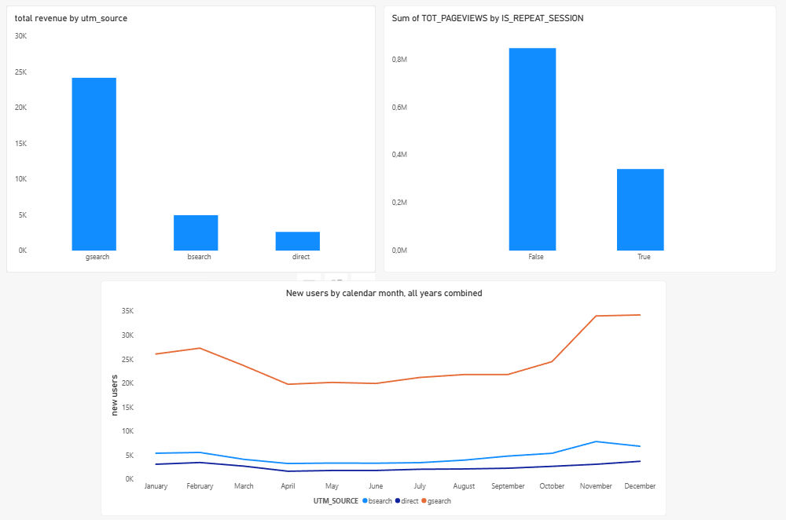
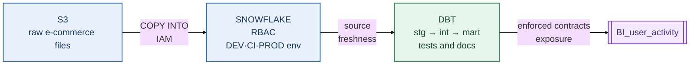
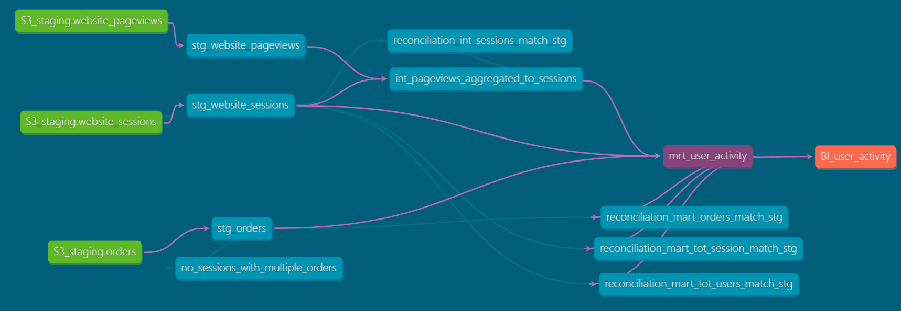

# E-commerce Growth Analytics: Raw Data to an Analyst-Ready Mart

Initial EDA on the raw source tables shows revenue grew **174% YoY**, but only **2% of customers place a second order**, and growth relies on paid acquisition. The Growth team wants to know which channels bring customers back and what those customers are worth.

## Business Problem

The Growth team's questions are hard to answer because the source data exists only at session, pageview, and order grain. There is no reliable user-level view, and joining these tables inflates sessions, pageviews, and revenue.

## My Transformation Layer Solution

- **Input:** raw session, pageview, and order tables at three different grains, with no user-level view.
- **Output:** `mrt_user_activity`, one row per user, enforced by a schema contract and a uniqueness test:
  - **Acquisition context:** first-session source, campaign, content, referrer, device, and landing URL.
  - **Retention and customer value:** second-session timing, total sessions, pageviews, orders, revenue, item totals.

Analysts can group by any acquisition attribute with no joins. Pageviews are pre-aggregated to session grain upstream to prevent fan-out, and user, session, and order totals reconcile back to staging through tests.

## Example Questions the Mart Enables

The charts below are **illustrative**: they show what an analyst can answer from this one table, not conclusions of this project.



## Data Lifecycle




## DAG



## Data Modelling
**Granularity**

| Layer | Model | Grain and role |
|---|---|---|
| Staging | `stg_website_sessions` | 1 row = session; `user_id` (FK) |
| Staging | `stg_website_pageviews` | 1 row = pageview. |
| Staging | `stg_orders` | 1 row = order; `user_id` (FK) |
| Intermediate | `int_pageviews_aggregated_to_sessions` | 1 row = session |
| Mart | `mrt_user_activity` | 1 row = user_id |

**Cardinality**

```text
user_id 1:N website_sessions
website_sessions 1:N website_pageviews (int model solving fanning-out)
website_sessions 1:0..1 orders (no_sessions_with_multiple_orders test)
```

## How I build the mart table

1. **[PR #4: Sessions]** - Established the one-row-per-user mart from session data, adding first- and second-session details, first-touch acquisition fields, and total sessions.
2. **[PR #5: Pageviews]** - Added pageview staging and an intermediate model that aggregates pageviews to one row per session, preventing join fan-out; added first URL and total pageviews to the mart.
3. **[PR #7: Orders]** - Extended the mart with first-order details, order totals, revenue, and items purchased, with reconciliation tests for order metrics.

## Testing Strategy

```text
S3-backed Snowflake sources (RAW.S3_STAGING)
	- Source freshness on `_loaded_at` (warn after 7 days)
			 |
			 v
Staging models
	- Enforced model contracts for the staging schema
	- Key uniqueness and not_null
	- Order/session/pageview relationships
	- `no_sessions_with_multiple_orders`: at most one order per session
			 |
			 v
Intermediate models
	- Session grain uniqueness
	- Reconcile session counts to staging
			 |
			 v
User retention mart
	- Enforced output schema contract
	- One-row-per-user uniqueness
	- Reconcile user and order totals
			 |
			 v
dbt build runs applicable model and data tests
```

## Environment Separation: Development, CI, and Production

The project separates fast iteration, isolated pull-request builds, and production runs:

| Environment | Target | Database | Role | Warehouse | Materialization and data scope |
|---|---|---|---|---|---|
| Development | `dev` | `ANALYTICS_DEV` | `DEV` | `DEV_WH` | Views; staging data limited to `created_at >= 2014-12-19` |
| CI | `ci` | `ANALYTICS_CI` | `CI_ROLE` | `CI_WH` | 1:1 with prod; isolated PR schema |
| Production | `prod` | `ANALYTICS_PROD` | `TRANSFORMER` | `PROD_WH` | Staging/intermediate views; marts are tables; full data scope |

## CI/CD

```text
CI: pull_request targeting main
	-> SQLFluff lint
	-> dbt Slim CI build for modified models and their downstream dependencies
		 in an isolated PR schema

CD: push to main
	-> dbt build --target prod
	-> Save the production manifest as a workflow artifact
		 for subsequent Slim CI runs
```

Both workflows use the project’s containerized dbt environment and GitHub Actions secrets for Snowflake credentials. CI uses the previous production manifest to defer unchanged upstream models when available; the production build generates the manifest used on later pull requests.